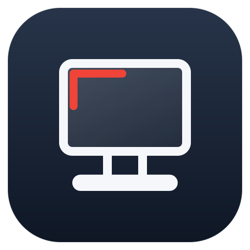
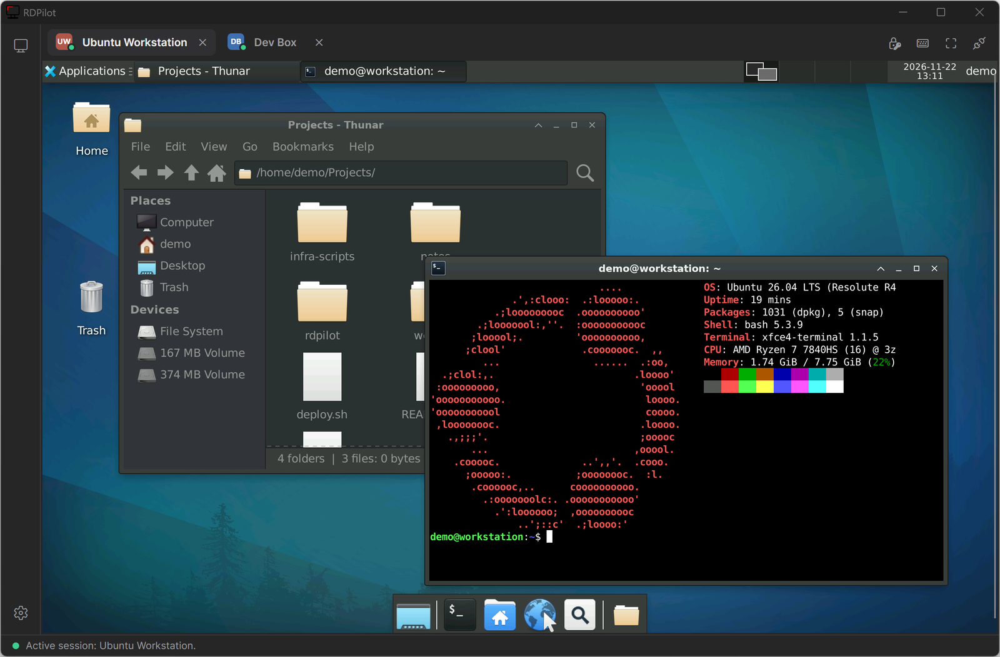
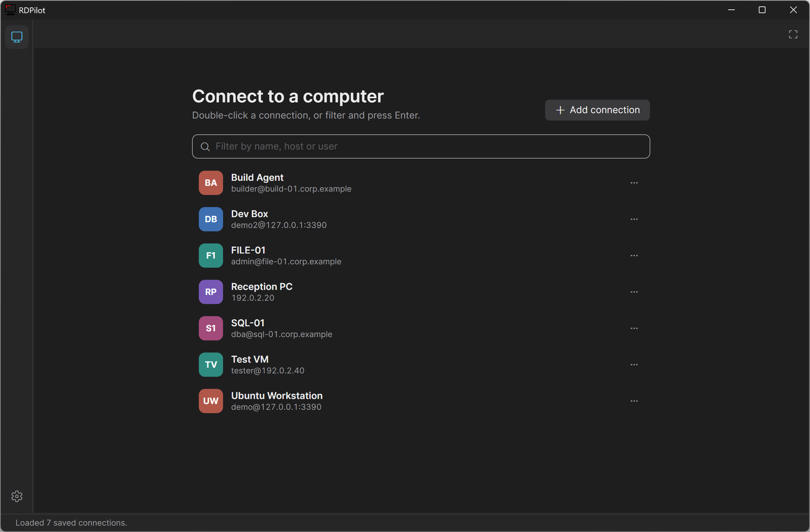
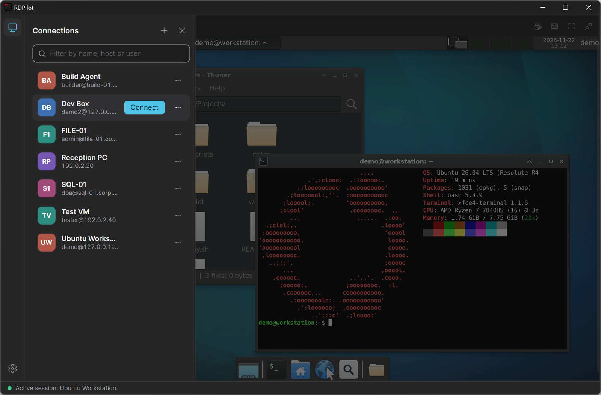
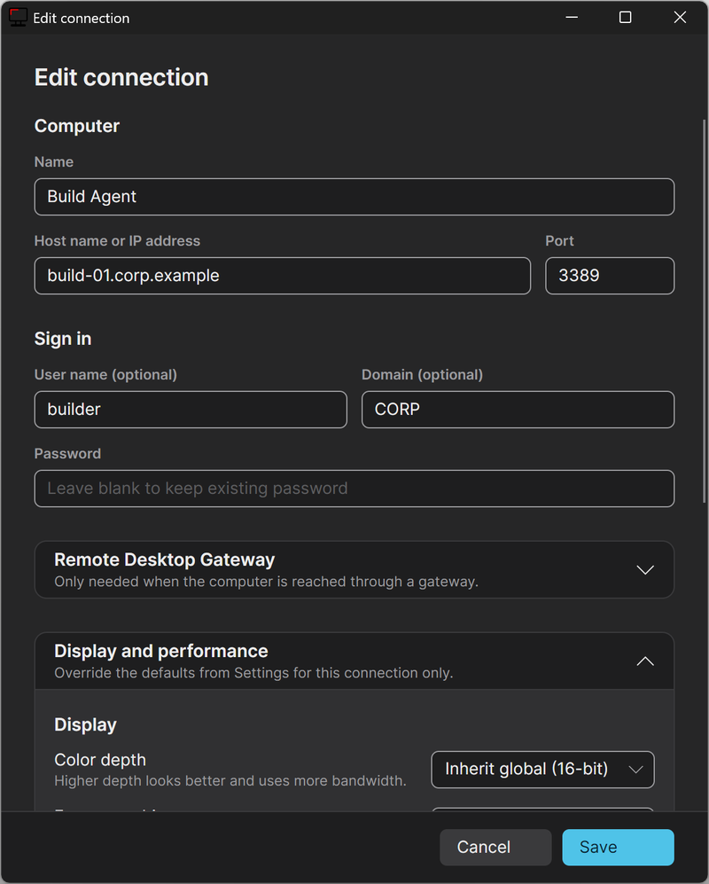
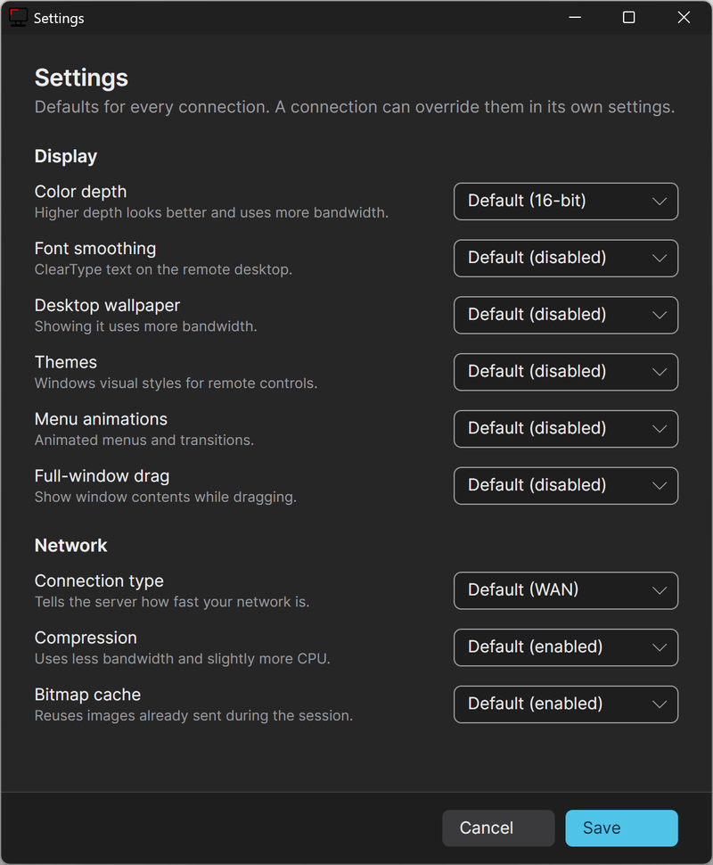

<p align="center">
  
</p>

<h1 align="center">RDPilot</h1>

<p align="center">
  A fast, modern Remote Desktop client for Windows and Linux, built on FreeRDP.
</p>

<p align="center">
  <a href="https://github.com/ErnieBernie10/RDPilot/releases/latest"></a>
  <a href="LICENSE"></a>
  
</p>

<p align="center">
  
</p>

<p align="center">
  <a href="docs/media/rdpilot-demo.mp4"><b>▶ Watch the 30-second demo</b></a>
</p>

RDPilot keeps all your remote machines one click away. Save your connections once, open as
many sessions as you like in tabs, and get a desktop that resizes with your window and
responds the moment you move the mouse.

## Highlights

- **Tabs for every session.** Each connection opens in its own tab. Background sessions stay
  connected while you work in another one.
- **Saved connections, safe passwords.** Find any machine by name, host or user. Passwords go
  into your operating system's credential vault, never into a config file.
- **Fits your window.** The remote desktop follows the size of the RDPilot window and stays
  sharp on high-DPI displays.
- **Responsive input.** Mouse movement is coalesced and keystrokes are delivered in order, so
  the session keeps up even on slower links.
- **Copy and paste across machines.** Text and files go both ways; images go from your
  computer to the remote one.
- **Keyboard grab (Windows).** Send `Win`, `Alt+Tab` and other shell shortcuts to the remote
  desktop, plus a one-click `Ctrl+Alt+Del`.
- **Quality that suits your network.** Global defaults for color depth, wallpaper, animations,
  compression and more, with per-connection overrides.
- **Remote Desktop Gateway** support and certificate prompts you can trust and remember.

## Screenshots

<table>
  <tr>
    <td width="50%"></td>
    <td width="50%"></td>
  </tr>
  <tr>
    <td align="center">Pick a computer to connect to</td>
    <td align="center">Open another connection without leaving your session</td>
  </tr>
  <tr>
    <td width="50%" align="center"></td>
    <td width="50%" align="center"></td>
  </tr>
  <tr>
    <td align="center">Edit a connection, with optional gateway and quality overrides</td>
    <td align="center">Default display and network settings</td>
  </tr>
</table>

## Install

### Windows

```powershell
winget install RDPilot.RDPilot
```

Or download the installer from the [latest release](https://github.com/ErnieBernie10/RDPilot/releases/latest).
It installs per user into `%LOCALAPPDATA%\Programs\RDPilot`; no administrator rights needed.

### Linux (Flatpak)

```sh
curl -LO https://github.com/ErnieBernie10/RDPilot/releases/latest/download/RDPilot.flatpak
flatpak install --user RDPilot.flatpak
```

A Flathub submission is in progress; once it lands, `flatpak install flathub io.github.ErnieBernie10.RDPilot` will work too.

### Arch Linux

Download the `rdpilot-<version>-1-x86_64.pkg.tar.zst` package from the
[latest release](https://github.com/ErnieBernie10/RDPilot/releases/latest) and install it:

```sh
sudo pacman -U rdpilot-*-x86_64.pkg.tar.zst
```

RDPilot is not on the AUR yet.

## Getting started

1. Click **Add connection**.
2. Enter the computer's host name or IP address, your user name and, if needed, a domain and
   a Remote Desktop Gateway.
3. Save. The password is stored in your operating system's credential store.
4. Double-click the connection, or type part of its name and press Enter.

Every connect opens a new tab, even for a computer that is already open. Switching tabs keeps
the other sessions connected; input, resizing and the clipboard only go to the tab you are
looking at.

### Keyboard grab

The keyboard button in the session toolbar sends your whole keyboard to the remote desktop, so
`Win`, `Alt+Tab`, `Ctrl+Esc` and `Alt+Esc` act there instead of on your own machine. While
grabbed, RDPilot's own interface does not respond to the keyboard. To release it, click the
button again or click any other window.

The grab is per session and never saved: new connections start ungrabbed, and switching tabs or
disconnecting releases it.

`Ctrl+Alt+Del` cannot be intercepted by any application, so use the toolbar button next to the
grab toggle to send it. `Win+L` always locks your local machine.

Keyboard grab is Windows only. On Linux the button is shown disabled: Wayland does not let
applications grab the keyboard, and the X11 path is not implemented yet. Sending
`Ctrl+Alt+Del` works everywhere.

## Your data

Connection details (no passwords) are stored per user in `connections.json`:

| Platform | Location |
| --- | --- |
| Windows | `%APPDATA%\RDPilot.Client\` |
| Linux | `$XDG_CONFIG_HOME/RDPilot.Client/`, or `~/.config/RDPilot.Client/` |
| macOS | `~/Library/Application Support/RDPilot.Client/` |

Passwords live in the system credential store: Windows Credential Manager, macOS Keychain, or
the Secret Service on Linux (through `secret-tool`).

Under Flatpak, libsecret prefers its sandboxed `file` backend: it takes a per-app key from the
`org.freedesktop.portal.Secret` portal and encrypts its own keyring inside
`~/.var/app/io.github.ErnieBernie10.RDPilot/data/keyrings/`. Those passwords are therefore
app-private: they do not appear in `seahorse` or `kwalletmanager`, they are **not shared with
the native package**, and `flatpak uninstall --delete-data` removes them. On desktops without a
Secret portal backend, libsecret falls back to the regular Secret Service and passwords land in
the system keyring as usual.

## Known limitations

- Audio playback and device redirection are not supported yet.
- Copying images from the remote machine to your computer, and HTML or other rich clipboard
  formats, are not supported yet.
- Keyboard grab is Windows only (see above).

## Building from source

RDPilot has two parts:

- `RDPilot.Client`: the .NET / Avalonia desktop app.
- `RDPilot.Wrapper`: a small native C library around the FreeRDP 3 APIs.

Building the client also configures and builds the native wrapper with CMake and copies it next
to the managed output. See [`docs/dependencies.md`](docs/dependencies.md) for the full
dependency inventory.

### Windows

Requirements: .NET SDK 10.0 or newer, CMake, Visual Studio Build Tools with the MSVC C/C++
toolchain, vcpkg, and Inno Setup 6 for installer builds.

```powershell
scripts/setup-windows-vcpkg.ps1   # prepare the vcpkg dependencies
scripts/run-windows.ps1           # build and run
scripts/build-windows.ps1         # build only
scripts/build-installer-windows.ps1 -AppVersion 0.1.0   # Release installer
```

The installer is written to `artifacts/installer/RDPilot-Setup-<version>-win-x64.exe`.

vcpkg is expected as a sibling of this repository, for example `C:/Users/<you>/Sources/vcpkg`
next to `C:/Users/<you>/Sources/rdp-client`. Pass `-VcpkgRoot` to use another location.

### Linux

Requirements: .NET SDK 10.0 or newer, CMake, a C compiler, pkg-config, the FreeRDP 3
development packages (`freerdp3`, `freerdp-client3`, `winpr3`), and `secret-tool` with a
working Secret Service session for password storage.

On Arch / CachyOS:

```sh
sudo pacman -S dotnet-sdk cmake gcc pkgconf freerdp
```

```sh
scripts/run-linux.sh                            # build and run
scripts/build-linux.sh                          # build only
scripts/build-linux.sh --configuration Release  # Release build
```

Or directly:

```sh
dotnet build RDPilot.slnx
dotnet run --project RDPilot.Client/RDPilot.Client.csproj
```

The native library is built at `RDPilot.Wrapper/build/native/libfreerdp_wrapper.so`.

### Flatpak

The manifest lives in `packaging/flatpak/`. Build and install it locally with:

```sh
flatpak run org.flatpak.Builder --force-clean --user --install --install-deps-from=flathub \
  --repo=repo build-dir packaging/flatpak/io.github.ErnieBernie10.RDPilot.yaml
```

## Advanced and troubleshooting

- The default rendering mode is `gfx-gdi` (RDPGFX). The legacy path is kept as a fallback:
  `RDPILOT_RENDERING_MODE=classic-gdi`.
- RDPGFX codec negotiation can be overridden with `RDPILOT_GFX_CODEC_POLICY=server`, `avc`,
  `avc420` or `sharp`. The default, `server`, lets the server choose.
- Frame acknowledgement pacing can be tested with `RDPILOT_GFX_FRAME_ACK=on|off`; QoE
  acknowledgements are enabled with `RDPILOT_GFX_QOE_ACK=on`.
- `RDPILOT_CONFIG_HOME` points RDPilot at a different settings directory, which is handy for
  testing with a separate set of connections.
- Console diagnostics include `[PERF_NATIVE]`, `[PERF_UI]`, `[PERF_INPUT]` and `[CLIPRDR]`
  logs.

## Releasing

Releases use `major.minor.patch` tags. The tag version becomes the .NET assembly version, the
Inno installer version, the GitHub Release asset names and the winget package version.

```powershell
git tag v0.1.0
git push origin v0.1.0
```

The release workflows publish:

| Workflow | Assets |
| --- | --- |
| Windows Installer | `RDPilot-Setup-<version>-win-x64.exe` and its `.sha256` |
| Linux Arch Package | `rdpilot-<version>-1-x86_64.pkg.tar.zst` and its `.sha256`, `PKGBUILD`, `.SRCINFO` |
| Flatpak | `RDPilot.flatpak` |

The generated `PKGBUILD` and `.SRCINFO` are release artifacts for now; the package is not on
the AUR yet.

Flatpak releases also need the version bumped in
`packaging/flatpak/io.github.ErnieBernie10.RDPilot.yaml`, a matching `<release>` entry in the
metainfo, and the module's git source pointed at the tag. See
[`packaging/flatpak/README.md`](packaging/flatpak/README.md).

### winget

Submit or update the winget package manually with `wingetcreate` after testing the installer.

```powershell
# first submission
wingetcreate new https://github.com/ErnieBernie10/RDPilot/releases/download/v0.1.0/RDPilot-Setup-0.1.0-win-x64.exe

# updates
wingetcreate update RDPilot.RDPilot --version 0.1.1 --urls https://github.com/ErnieBernie10/RDPilot/releases/download/v0.1.1/RDPilot-Setup-0.1.1-win-x64.exe
```

Package values:

```text
PackageIdentifier: RDPilot.RDPilot
PackageName: RDPilot
Publisher: RDPilot
PackageVersion: 0.1.0
PackageUrl: https://github.com/ErnieBernie10/RDPilot
PublisherUrl: https://github.com/ErnieBernie10/RDPilot
ShortDescription: Fast Avalonia RDP client backed by FreeRDP.
Moniker: rdpilot
InstallerType: inno
Scope: user
Architecture: x64
```

## License

RDPilot is released under the [MIT License](LICENSE).
